<p align="center">
  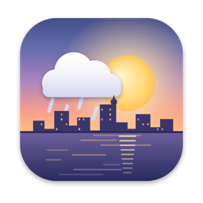
</p>

<h1 align="center">Dhaka Sky</h1>

<p align="center">
  <b>A living, illustrated wallpaper of Dhaka for your Mac.</b><br>
  The sky follows Dhaka's real weather, sun and moon. Rickshaws pedal by, boats drift, and it rains when it rains in Dhaka.
</p>

<p align="center">
  
  
  
  
</p>

<p align="center">
  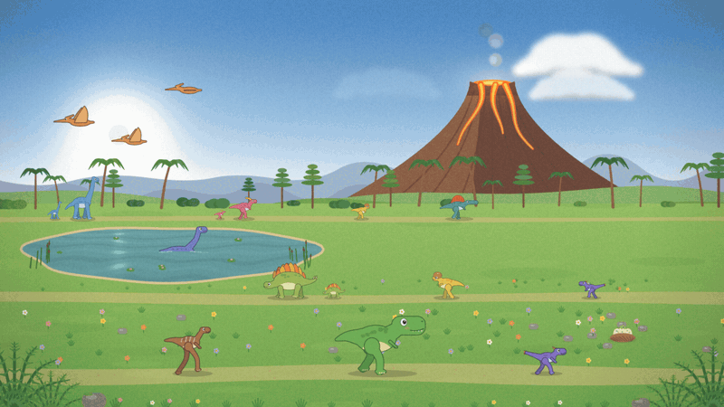
</p>

## What is it?

Dhaka Sky replaces your desktop picture with a hand-drawn, always-moving scene of Dhaka. It lives in the menu bar and keeps the scene in step with the real city:

- **Live weather** from [Open-Meteo](https://open-meteo.com) (no API key): clear, clouds, overcast, fog, drizzle, rain and thunderstorms, plus winter smog from the PM2.5 reading.
- **The real sky:** the sun and moon sit where they actually are over Dhaka right now, and the moon shows the correct phase.
- **Street life:** rickshaw-wallahs pedalling, CNGs, buses, boats on the lake, birds, aeroplanes, and people who open umbrellas when it starts to rain.
- **Seasons:** Krishnachura trees blossom red from April to June, and winter mornings are misty.
- **Gentle on your Mac:** it pauses when the desktop is hidden or the screen sleeps, and drops to 20 fps on battery.

Everything is drawn in code. There are no stock photos or video files, just Core Graphics painting and SpriteKit animation.

## A day in Dhaka

The light changes through the day, from dawn to sunset to a night of lit windows and street lamps.

<p align="center">
  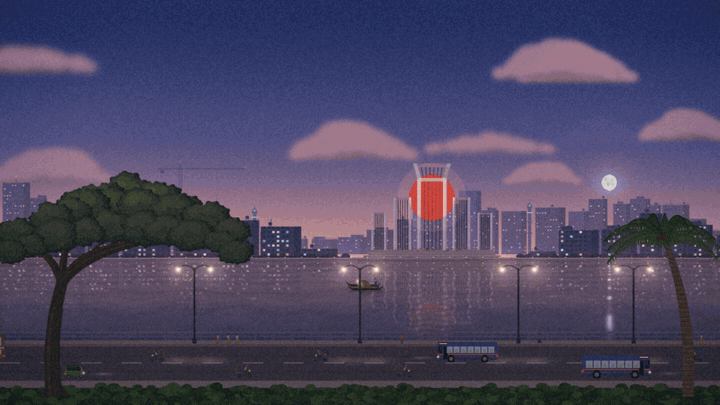
</p>

## Whatever the weather

Rain, fog, overcast skies and thunderstorms with lightning (and optional thunder you can hear).

<p align="center">
  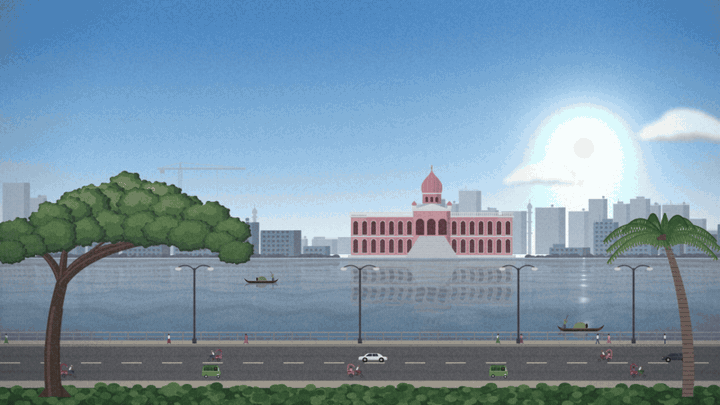
</p>

## Views

Pick a view from the menu bar or Settings, or let it rotate daily.

| | |
|:-:|:-:|
| 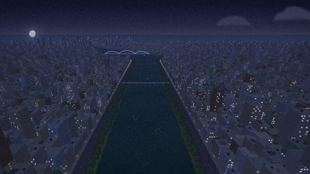<br>**Hatirjheel from above**<br>Aerial view down the canal at night | 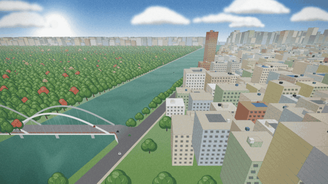<br>**Gulshan Lake bridge**<br>Traffic over the arch bridge and the lakeside road |
| 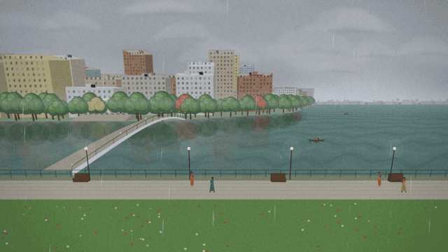<br>**Dhanmondi Lake**<br>Promenade, footbridge and rowing boats | 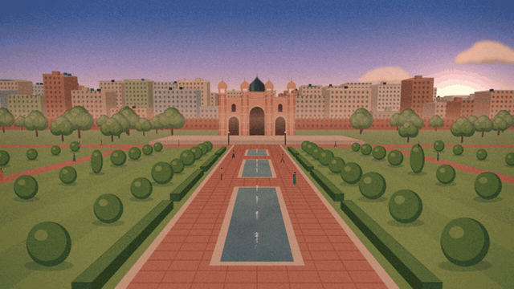<br>**Lalbagh Fort gardens**<br>Pari Bibi's tomb, fountains and topiary |
| 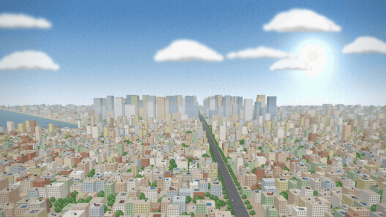<br>**City panorama**<br>Rooftops and greenery to the horizon | 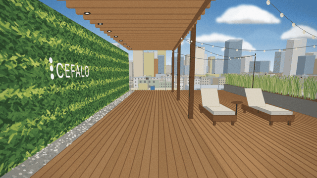<br>**Cefalo rooftop**<br>A green wall and deck above the city |
| <br>**Dinosaur World**<br>12 friendly species, Pteranodons and a smoking volcano, made for little ones | 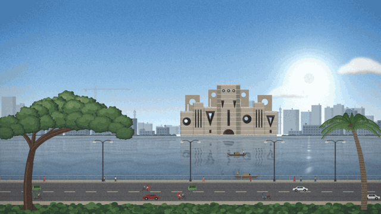<br>**Lakeside skyline**<br>Choose the landmark across the lake |

**Landmarks for the lakeside view:** Jatiya Sangsad Bhaban (Parliament), Central Shaheed Minar, Ahsan Manzil, Sat Gambuj Mosque, Hatirjheel, Lalbagh Fort and Padma Bridge. You can also use **your own image**: Dhaka Sky cuts the subject out automatically with Apple's Vision framework.

**Your own photos** can be views too. Add one under Settings > View and the weather, rain, fog and day/night lighting are layered on top of it.

## Lock screen

- **Still picture:** Dhaka Sky keeps a still of the current view as your desktop picture, which macOS shows on the lock screen. It refreshes every 1, 2, 5, 10 or 15 minutes (your choice) and the moment you lock. Turn it off and your original picture comes back.
- **Animation:** macOS only lets a screen saver animate over the lock screen, so the project also builds `Dhaka Sky.saver`. When you lock, the app starts it and the same live scene plays. Settings > Display has a **Use Dhaka Sky as Screen Saver** button, and shows a green tick once it is selected.

## Install

You need macOS 14 Sonoma or later and the Xcode Command Line Tools (`xcode-select --install`).

```sh
git clone https://github.com/PYSHAWON/DhakaSky.git
cd DhakaSky
./build-app.sh
open ~/Applications/Dhaka\ Sky.app
```

`build-app.sh` builds a release copy, installs **Dhaka Sky.app** into `~/Applications`, and installs the screen saver into `~/Library/Screen Savers`. The app is ad-hoc signed, so if macOS blocks the first launch, right-click the app and choose **Open**.

## Using it

Click the weather icon in the menu bar to:

- switch views and landmarks
- turn elements on or off (traffic, people, boats, birds, aeroplanes, trees)
- preview any weather or time of day
- turn on the ambient sound: rain, thunder that follows the lightning, the hum of the city and rickshaw bells (off by default)
- dim the wallpaper, change the frame rate, or launch at login

Everything is also in **Settings** (menu bar > Settings..., or Cmd+,).

## How it works

| Part | Files |
|---|---|
| Menu bar app, one borderless window per screen at desktop level | `AppDelegate.swift`, `WallpaperWindow.swift` |
| Scene, sky, sun, moon, clouds, rain, lightning, reflections | `CityScene.swift`, `ArtSky.swift`, `Look.swift`, `Solar.swift` |
| Lakeside skyline, landmarks and street props | `ArtCity.swift`, `ArtLandmarks.swift`, `ArtProps.swift` |
| Perspective views, drawn by a small 3D painter (boxes, lanes, painter's algorithm) | `ArtViews.swift`, `ArtViews2.swift`, `ScenicView.swift` |
| Dinosaur World (parametric dinosaurs with walk cycles, volcano, lake) | `ArtDinos.swift`, `ArtDinoWorld.swift`, `DinoLife.swift` |
| Live weather and air quality | `Weather.swift` |
| Generated ambient sound | `SoundScape.swift` |
| Lock-screen still and screen saver sync | `LockScreen.swift`, `Saver/SaverView.swift`, `build-saver.sh` |

## Preview frames without touching your desktop

```sh
swift build
./render.sh /tmp "dusk rain parliament" "night clear none hatirjheel"   # time weather landmark [view]
```

- **Times:** live, dawn, morning, noon, afternoon, sunset, dusk, night
- **Weather:** clear, partlyCloudy, overcast, fog, drizzle, rain, heavyRain, thunderstorm
- **Views:** lakeside, hatirjheel, gulshan, dhanmondi, lalbagh, panorama, cefalo, dinos

For an animation, add `--frames 48 --fps 12` to a `--snapshot` command to write a numbered PNG sequence. The GIFs in this README were made that way with `ffmpeg`.

Other test hooks: `--settings-preview out.png`, `--sound-test`, `--import landmark|scene <image>` and `--select-saver`.

## Privacy

Dhaka Sky makes one kind of network request: weather and air quality for Dhaka from Open-Meteo, every 15 minutes. It collects nothing and sends nothing about you. Your custom images stay in `~/Library/Application Support/DhakaSky/`.

## Credits

- Weather data by [Open-Meteo](https://open-meteo.com) (CC BY 4.0).
- Made with love for Dhaka, and for a 2.5-year-old who asked for dinosaurs.

## License

[MIT](LICENSE)
